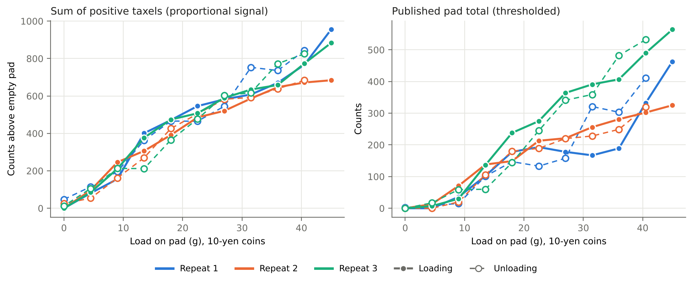

# FlexiGrasp

Tactile sensing for a two-finger gripper. Two FlexiTac pads (GD510 film, 16x32 taxels each, one per
finger) are read over USB serial by a ROS 2 node that publishes each pad as a topic, and a live
viewer shows both pads side by side. It runs on its own for now and is meant to be merged into the
Open Manipulator X6 workspace later.

```
src/flexigrasp_msgs/   TactileFrame message (raw values, baseline-subtracted values, contact features)
src/flexigrasp/        flexigrasp_node (serial -> topics), flexigrasp_gui (live view), launch, config
analysis/              Jupyter notebooks, one per test, and the bag reader they share (see Analysis)
```

## One-time setup

```bash
sudo apt install python3-serial python3-tk python3-matplotlib python3-numpy
sudo usermod -aG dialout $USER        # then log out and back in
```

## Build

```bash
cd ~/FlexiGrasp
rm -rf build install log              # only if you built before without --symlink-install
colcon build --symlink-install
source install/setup.bash             # in every new terminal
```

## Run

Left pad on `/dev/ttyUSB0`, right pad on `/dev/ttyUSB1` (change in `src/flexigrasp/config/flexigrasp.yaml`).

```bash
ros2 launch flexigrasp flexigrasp.launch.py              # node + live viewer
ros2 launch flexigrasp flexigrasp.launch.py demo:=true   # simulated pads, no hardware
ros2 launch flexigrasp flexigrasp.launch.py gui:=false   # node only
```

Keep both pads unloaded (gripper open, nothing touching) for the first second after launch while the
baselines are taken. Re-zero later with the viewer buttons, `r`, or
`ros2 service call /flexigrasp/rezero_all std_srvs/srv/Trigger`.

Viewer keys: `r` re-zero both, `v` raw/delta, `+`/`-` color range, `space` pause, `q` quit.

## Topics

| Topic | Type |
|---|---|
| `/flexigrasp/left/frame`, `/flexigrasp/right/frame` | `flexigrasp_msgs/TactileFrame` (~98 Hz) |
| `/flexigrasp/left/image`, `/flexigrasp/right/image` | `sensor_msgs/Image` (mono8, for `rqt_image_view`) |

`TactileFrame.total` (sum of delta above the contact threshold) is the contact/grip signal;
`in_contact`, `contact_taxels`, `centroid_row/col` describe where the contact is.
For force estimates, prefer the sum of positive baseline-subtracted values (see Calibration below):
`total` has a dead zone at light loads.

## Record

```bash
ros2 bag record /flexigrasp/left/frame /flexigrasp/right/frame /joint_states
```

Arm tests run through the X6 package (`bottle_test.launch.py`) log to `~/flexigrasp_logs/`: a CSV, a
`_steps.csv` and a bag per run. Source both workspaces in the terminal that launches them, or the pad
topics are skipped.

## Analysis

```
analysis/
  flexigrasp_bag.py             reads the .db3 bags directly (no ROS needed): pad frames, joint states,
                                sequence steps, Float32 topics
  01_coin_calibration.ipynb     pad -> load with coins
  02_marker_pick_place.ipynb    marker from the table into a bowl, 10 runs
  03_squeeze_pilot.ipynb        current-step squeezes: bottle and sponge
```

Each notebook states its setup and questions, runs the analysis, and ends with its findings. Set the
data folder in the first code cell (`COIN_DIR`, `LOG_DIR` or `SQ_DIR`), then run all cells.
Run them with `pip install notebook matplotlib` and then `jupyter notebook`, using the same Python each time.

GRACE claims referred to below: **(1)** grip-relevant compliance can be estimated from motor signals
alone; **(2)** touch adds what the motor cannot see; **(3)** an adaptive grip beats a fixed grip.

| Notebook | Test | Key findings | Contribution to GRACE |
|---|---|---|---|
| `01_coin_calibration` (13 Nov) | Left pad facing up, 10-yen coins 0 → 45 g → 0, 3 repeats | ~17 counts/g (R² 0.95–0.97) on the positive-taxel sum; **no saturation up to 45 g**; `total` has a dead zone below ~5–9 g; repeats within ±5–18% | Sets the pad force signal (positive-taxel sum) and corrects the "19 g saturation" assumption. Stage 0 calibration for claim 2 |
| `02_marker_pick_place` (13 Nov) | Marker from the table into a bowl, gripper saved in the poses, cap 80, 10 runs | 10/10 success, no slips; grip held at the cap (0.215 A); during carry the pad signal dips at most ~10% within 100 ms; contact 2.03–2.14 s after `grasp` starts | **Fixed-grip baseline** for claim 3, and the noise floor a slip alarm must exceed. Showed the right pad's mounting problem (fixed 14 Nov) |
| `03_squeeze_pilot` (14 Nov) | Current cap 30 → 120 → 30 in steps of 10, 9 s holds; bottle near the top (4 runs), sponge narrow side (5 runs) | Sponge closes ~2× further than the bottle (0.41 vs 0.20 rad; ~0.6 vs ~1.2 A/rad). The jaw moves in **jumps** (gear friction): the current rises between jumps but the pads stay flat, and on unloading the jaw stays locked. The pads level out at cap 100–120 for the bottle and 90–100 for the sponge, at a jaw jump | **Claim 1:** objects separate on motor signals alone (loading branch). **Claim 2:** the pads follow the real jaw force while the current does not under friction; pad balance flags a poorly seated grasp. Sets the protocol for Experiment A |

### Notes carried forward

- **Protocol for Experiment A** (from `03`): `close_sign: 1.0` in every sequence file; `squeeze_rad: 0.9`
  for soft objects; cap steps of 20 with 5 s holds; only one or two unloading steps; the load cell
  must be stepped up **and** down to measure the friction band.
- **Power:** the arm stopped responding during two sponge runs with no driver error, most likely a brief
  power dip at high gripper current. Check the supply before long runs.
- **Bottle runs:** the bottle leans slightly on the left finger after release, which leaves a residual
  on the left pad. That is contact, not a mount problem.

## Calibration

### Pad → load with coins (13 Nov 2026)



**Setup.** Left pad on the X6 finger, facing up and level. 10-yen coins (4.5 g each, 23.5 mm across),
stacked centred with no plate, 0 → 45 g → 0 in 4.5 g steps, about 5 s per step, 3 repeats without
re-zeroing between them. The load was labelled in the bag with `coin_marker.py` (`/calib_load_g`).
Full analysis: `analysis/01_coin_calibration.ipynb`.

**Key findings**

| | Sum of positive taxels | Published `total` |
|---|---|---|
| Response to load | Rises steadily to at least 45 g; slight bend above ~25 g | Rises to at least 45 g, but unevenly |
| Sensitivity | **~17 counts/g** (15–19 across repeats, R² 0.95–0.97), 23.5 mm contact | Not linear enough to quote one value |
| Smallest load seen | 4.5 g (first coin) | ~5–9 g (dead zone below that) |
| Spread between repeats | ±5–18% | ±20–40% |

- **No saturation up to 45 g.** The earlier "pads flatten out around 19 g" was wrong. The light weights
  in the 9 Oct test barely registered because of the dead zone at low load, not saturation.
- **Use the sum of positive taxels as the force signal** (`sum(max(delta, 0))` over the pad). `total`
  ignores taxels below the contact threshold, so it misses light touches and jumps when the contact
  shifts.
- **Placement matters.** In repeat 1, `total` stayed flat between 18 and 36 g and then jumped when the
  contact centre moved 2–3 taxels. The positive sum was much less affected.
- **Loading vs unloading:** no consistent hysteresis. The 10–40% differences, mostly at light loads,
  go both ways and come from handling the coins.
- **Settling:** readings still drifted during many 5 s holds (up to 20–40 counts/s). Hold calibration
  steps 8–10 s and use the last few seconds.
- **Zero offset after unloading:** about 10–50 counts (1–3 g). Re-zero before each grasp.

**Limits.** One pad, one contact size (23.5 mm disc) and loads up to 45 g only. The counts per gram
change with contact area (the sponge in `03` lit ~115 taxels per pad, the bottle neck 23–46), so check
them against the load cell between the jaws before using them as grip force.

### Pad mounting (14 Nov 2026)

Both pads are mounted the same way on the TPU fingers, kept compliant on purpose so the fingers can
conform to objects. After remounting, the two pads read within a few percent of each other on the
sponge. The TPU's own give is part of every squeeze measurement; the rigid-block run measures it.

### Next: load cell between the jaws

Squeeze a load cell (HX711) between the pads at stepped gripper current caps, stepping **up and back
down** and holding each step 5–10 s. This gives current → force for the X6 gripper, including the
gear-friction band seen in `03`, and pad → force at higher loads and grasp-sized contacts.

## If something goes wrong

- `Permission denied` on the port: not in the `dialout` group (see setup).
- Left and right swapped: the USB numbers can change; see `src/flexigrasp/udev/99-flexigrasp.rules.example`.
- Viewer says NO DATA: the node is not running or the ports are wrong; read the node's log lines.
- Build error about a symbolic link: delete `build install log` and rebuild with `--symlink-install`.
- `No module named 'flexigrasp_msgs'`, or the bag says a pad topic has an "unknown type": the FlexiGrasp
  workspace is not sourced in that terminal.
- The arm stops responding mid-run with no error: check the power supply (see Notes carried forward).